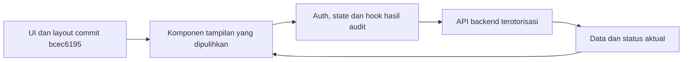

# Implementation Plan: pemulihan UI/UX sebelum audit

Status: disetujui pengguna; implementasi dan verifikasi selesai pada 28 Oktober 2026. Salinan working tree sebelum pemulihan disimpan di direktori sementara lokal.

## Acuan dan hasil yang dituju

Repository: `arrhythmia-detection-dashboard`.

Acuan UI sebelum perubahan audit: `bcec619591c6566f0e542c17efeea1cc295400a8` (`fix: display full session ID in PatientHistoryPage`). Perubahan audit saat ini masih berupa working tree; simpan salinan working tree frontend sebelum implementasi agar hasil audit dan pekerjaan pengguna dapat dipulihkan.

Pulihkan seluruh bahasa visual dan interaksi yang digunakan aplikasi sebelum audit: susunan halaman, sidebar/header/footer, ukuran/warna/font, kartu, tabel, form, modal, filter, pagination, kontrol ECG dan perilaku responsif. Gunakan markup/kelas/struktur dari commit acuan dan sambungkan kembali ke state serta handler yang berlaku saat ini.

Autentikasi Supabase, otorisasi server, API privat, impersonation, kode consent/pairing, status ACK, checksum, kalibrasi ECG, sample rate, label UNKNOWN dan pengolahan worker tetap menjadi sumber perilaku/data. Teks/status/nilai mengikuti data sebenarnya. Halaman reset/monitor baru mengikuti desain sebelum audit.

## Langkah implementasi dan file

Semua path berikut relatif terhadap root frontend. Edit hanya bagian yang diperlukan pada file yang tercantum. File dengan desain yang sudah sama dengan acuan cukup diverifikasi. `HomePage.tsx`, `HowItWorksPage.tsx`, `SplashPage.tsx`, aset dan tema Tailwind yang masih sama dengan baseline dipakai kembali tanpa penulisan ulang. Komponen template/tidak terpakai yang dahulu dihapus tidak diperlukan untuk mengembalikan tampilan halaman aktif.

### 1. Kerangka aplikasi dan tema

| File | Perubahan spesifik |
|---|---|
| `src/App.tsx` | Pulihkan judul halaman, navigasi dan tampilan 404 lama melalui ErrorPage; pertahankan AuthProvider, RequireRole, lazy loading dan rute baru yang sudah berfungsi. |
| `src/index.css` | Sesuaikan gaya global dengan baseline dan pastikan kelas aksesibilitas tidak mengubah layout normal. |

### 2. Navigasi, header dan footer

| File | Perubahan spesifik |
|---|---|
| `src/presentation/components/layout/AdminSidebar.tsx` | Cocokkan sidebar, lebar, collapse, ikon, jarak dan menu mobile dengan baseline; hubungkan rute monitor yang aktif. |
| `src/presentation/components/layout/DoctorSidebar.tsx` | Cocokkan sidebar dokter, collapse, menu mobile dan navigasi monitor dengan baseline. |
| `src/presentation/components/layout/Header.tsx` | Pulihkan susunan header, avatar, aksi, indikator dan breakpoint lama dengan identitas server. |
| `src/presentation/components/layout/PatientHeader.tsx` | Pulihkan header dan navigasi pasien pada desktop/mobile menggunakan AuthContext dan ID profil yang benar. |
| `src/presentation/components/layout/PublicHeader.tsx` | Pertahankan/pulihkan menu publik, avatar dan perilaku scroll lama; gunakan identitas terverifikasi untuk tautan dashboard. |
| `src/presentation/components/layout/PublicFooter.tsx` | Pulihkan kolom, navigasi, branding dan spacing footer baseline; tampilkan keterangan sesuai kemampuan aplikasi. |

### 3. Monitor ECG dan peninjauan rekaman

| File | Perubahan spesifik |
|---|---|
| `src/presentation/components/dashboard/MonitorPanel.tsx` | Kembalikan toolbar, kontrol perekaman, susunan panel, filter, kalibrasi dan kartu monitor seperti PatientMonitorPage baseline; tetap gunakan useECGStream/useDeviceCommands dan status ACK. |
| `src/presentation/components/dashboard/SessionList.tsx` | Pulihkan tampilan daftar sesi, pemilih pasien, pagination, filter, upload dan navigasi detail dari halaman sesi/history baseline dengan API saat ini. |
| `src/presentation/components/dashboard/SessionReview.tsx` | Pulihkan layout detail/analitik, timeline, panel review, unduhan dan aksi sesi; pertahankan hak akses, waktu asli dan metadata frame. |
| `src/presentation/components/dashboard/EcgViewer.tsx` | Pulihkan toolbar, ikon, panel filter, pilihan kecepatan/gain, pemutar, scrubber dan bingkai grafik baseline; pertahankan sample rate, worker dan koordinat hasil audit. |
| `src/presentation/components/dashboard/VitalCard.tsx` | Pulihkan struktur kartu vital baseline; nilai tidak tersedia tetap ditampilkan secara jujur. |
| `src/presentation/components/dashboard/AiCard.tsx` | Pulihkan struktur, hierarki dan panel informasi AI baseline dengan hasil aktual dan status UNKNOWN. |
| `src/presentation/components/dashboard/DeviceCard.tsx` | Pulihkan tampilan kartu perangkat baseline menggunakan telemetry/freshness aktual. |
| `src/presentation/components/canvas/ECGCanvas.tsx` | Cocokkan tampilan grid, label dan bingkai baseline bila berbeda; pertahankan kalibrasi, polaritas aVR dan transformasi waktu hasil audit. |

### 4. Komponen interaksi bersama

| File | Perubahan spesifik |
|---|---|
| `src/presentation/components/shared/Avatar.tsx` | Pertahankan ukuran, bentuk dan fallback avatar baseline dengan pemuatan foto privat yang sudah diamankan. |
| `src/presentation/components/shared/FolderUploadModal.tsx` | Pulihkan modal upload, pemilih folder, progress dan aksi baseline menggunakan alur upload tervalidasi saat ini. |
| `src/presentation/components/shared/LogoutModal.tsx` | Pulihkan tampilan modal konfirmasi baseline menggunakan logout SDK dan penghentian impersonation yang benar. |
| `src/presentation/components/shared/Pagination.tsx` | Pulihkan tombol, nomor halaman, label dan responsivitas pagination baseline. |
| `src/presentation/components/shared/ScreenCalibrationModal.tsx` | Pulihkan bahasa visual modal/ruler baseline dengan kalibrasi fisik yang benar. |
| `src/presentation/components/shared/TimelineBar.tsx` | Pulihkan bentuk marker, seleksi dan scrolling timeline baseline dengan nomor frame/waktu asli. |
| `src/presentation/components/shared/QrReader.tsx` | Sesuaikan bingkai kamera, loading, error dan fallback manual dengan halaman scanner baseline; pertahankan cleanup kamera dan validasi kode. |

### 5. Halaman publik dan autentikasi

| File | Perubahan spesifik |
|---|---|
| `src/presentation/pages/landing/FaqPage.tsx` | Pulihkan susunan accordion, kategori, spacing dan interaksi FAQ baseline dengan jawaban yang sesuai perilaku aplikasi. |
| `src/presentation/pages/auth/LoginPage.tsx` | Pulihkan layout/form login, label, tombol, ilustrasi dan feedback baseline melalui Supabase Auth saat ini. |
| `src/presentation/pages/auth/RegisterPage.tsx` | Pulihkan layout/form pendaftaran, pemilih peran dan interaksi baseline; pertahankan validasi, konfirmasi email dan retry provisioning. |
| `src/presentation/pages/auth/ResetPasswordPage.tsx` | Selaraskan halaman baru dengan desain auth baseline sambil mempertahankan alur reset yang berfungsi. |

### 6. Halaman admin

| File | Perubahan spesifik |
|---|---|
| `src/presentation/pages/admin/AdminDashboardPage.tsx` | Pulihkan header dashboard, kartu statistik, grid dan interaksi baseline menggunakan /api/admin/stats. |
| `src/presentation/pages/admin/AdminUsersPage.tsx` | Pulihkan tabel, pencarian/filter, tab, form/modal dan aksi pengguna baseline; gunakan provisioning dan impersonation server. |
| `src/presentation/pages/admin/AdminDevicesPage.tsx` | Pulihkan tabel/perangkat, filter, form/modal dan kontrol baseline; tetap validasi broker/topik dan izin pada server. |
| `src/presentation/pages/admin/AdminSessionsPage.tsx` | Pulihkan layout pengelolaan sesi, filter, pemilih pasien, pagination, modal dan aksi baseline melalui SessionList/SessionReview. |
| `src/presentation/pages/admin/AdminAnalyticsPage.tsx` | Pulihkan kerangka analitik, navigasi daftar/detail, panel review dan timeline baseline menggunakan hook peninjauan saat ini. |
| `src/presentation/pages/admin/AdminMonitorPage.tsx` | Terapkan desain monitor baseline pada rute admin yang baru berfungsi, dengan pemilih pasien dan status perekaman server. |

### 7. Halaman dokter

| File | Perubahan spesifik |
|---|---|
| `src/presentation/pages/doctor/DashboardPage.tsx` | Pulihkan ringkasan, daftar/kartu pasien, filter, modal dan interaksi dashboard baseline dengan daftar pasien yang diotorisasi. |
| `src/presentation/pages/doctor/AnalyticsPage.tsx` | Pulihkan layout analitik/detail ECG baseline melalui SessionList/SessionReview dan izin review dokter. |
| `src/presentation/pages/doctor/MonitorPage.tsx` | Terapkan desain monitor baseline melalui MonitorPanel untuk pasien yang ditugaskan. |
| `src/presentation/pages/doctor/ProfilePage.tsx` | Pulihkan struktur profil, form, foto dan panel keamanan baseline dengan endpoint profil/Auth saat ini. |
| `src/presentation/pages/doctor/QrScannerPage.tsx` | Pulihkan layout kamera, bingkai, petunjuk, modal dan fallback input baseline dengan consent code yang berlaku. |

### 8. Halaman pasien

| File | Perubahan spesifik |
|---|---|
| `src/presentation/pages/patient/PatientDashboardPage.tsx` | Pulihkan hero/ringkasan, susunan kartu, tautan cepat dan panel koneksi baseline menggunakan data API sebenarnya. |
| `src/presentation/pages/patient/PatientMonitorPage.tsx` | Pulihkan kerangka halaman monitor dan header baseline dengan MonitorPanel hasil penyesuaian. |
| `src/presentation/pages/patient/PatientHistoryPage.tsx` | Pulihkan daftar riwayat, kartu/tabel, pencarian/filter, skeleton, pagination dan navigasi baseline melalui API sesi terotorisasi. |
| `src/presentation/pages/patient/PatientHistoryDetailPage.tsx` | Pulihkan header, kembali, detail sesi, timeline dan susunan ECG baseline dengan SessionReview dan waktu asli. |
| `src/presentation/pages/patient/PatientProfilePage.tsx` | Pulihkan tab, form profil, foto, modal dan panel keamanan baseline; pertahankan pemetaan identitas dan tanggal lahir yang benar. |
| `src/presentation/pages/patient/PatientQrSyncPage.tsx` | Pulihkan desain QR, petunjuk, status dan interaksi sinkronisasi baseline menggunakan kode consent kedaluwarsa/satu pakai. |
| `src/presentation/pages/patient/PatientDeviceScannerPage.tsx` | Pulihkan layout pairing, kamera, instruksi dan fallback manual baseline menggunakan kode perangkat yang divalidasi server. |
| `src/presentation/pages/patient/PatientSettingsPage.tsx` | Pulihkan kategori, kartu, toggle dan interaksi pengaturan baseline dengan preferensi aman dan aksesibilitas yang berfungsi. |

### 9. Pengujian dan bukti

| File | Perubahan spesifik |
|---|---|
| `src/testing/EcgViewer.test.tsx` | Sesuaikan selector dengan kontrol tampilan lama; pertahankan pengujian playback, filter dan waktu pada sample rate sebenarnya. |
| `src/testing/PatientMonitorPage.test.tsx` | Verifikasi kontrol monitor lama tetap mengirim perintah server dengan status requested/ACK dan error yang benar. |
| `src/testing/PatientHistoryDetailPage.test.tsx` | Verifikasi layout detail lama mempertahankan waktu/frame asli dan data sesi yang benar. |
| `e2e/access.spec.ts` | Pertahankan pemeriksaan akses/login/reset dan sesuaikan selector bila label/layout berubah. |
| `e2e/roles.spec.ts` | Pertahankan skenario pasien/dokter/admin, review dan isolasi identitas setelah pemulihan UI. |
| `e2e/fixtures/api.ts` | Buat fixture Auth/API bersama dengan data sintetis untuk skenario peran dan pemulihan UI; hindari koneksi data produksi. |
| `e2e/ui-restoration.spec.ts` | Buat cakupan desktop/mobile untuk navigasi, collapse sidebar/menu, form/modal dan susunan halaman utama; hasilkan artefak screenshot untuk perbandingan baseline. |

### 10. Dokumentasi dan commit

| File | Perubahan spesifik |
|---|---|
| `docs/ui-restoration-plan.md` | Dokumen rencana ini; catat baseline, cakupan dan hasil pemulihan setelah persetujuan. |
| `docs/verification.md` | Perbarui hasil typecheck/lint/unit/browser/build dan batas verifikasi visual. |
| `docs/verification.json` | Perbarui fingerprint source dan jumlah pengujian setelah implementasi. |
| `docs/commit-commands.md` | Siapkan kelompok commit Conventional Commits dengan git add file eksplisit; pisahkan pemulihan UI, pengujian dan dokumentasi. |

## Urutan verifikasi

1. Catat fingerprint/salinan source audit sekarang dan buat artefak visual acuan dari commit baseline dengan data sintetis. Jangan memakai `.env` atau data pribadi produksi untuk pembandingan browser.
2. Pulihkan komponen bersama, lalu halaman per peran; sambungkan markup baseline dengan state/handler hasil audit. Periksa dashboard, form, scanner, daftar sesi, monitor dan detail rekaman.
3. Jalankan `npm run typecheck`, `npm run lint`, `npm test`, `npm run test:e2e` dan `npm run build`. Sesuaikan hanya pengujian yang terdampak; pertahankan pengujian keamanan, kalibrasi dan kontrak data.
4. Periksa screenshot desktop dan mobile untuk halaman publik/auth, pasien, dokter dan admin, serta keadaan loading/kosong/error. Simpan perbandingan sebagai artefak lokal yang dikecualikan Git. Pastikan sidebar tidak menutupi konten, menu mobile bekerja dan tabel/ECG dapat digunakan pada layar kecil.
5. Catat hasil aktual dan siapkan perintah commit atomik. Tidak menjalankan git add/commit/push, deployment, perubahan backend atau migrasi database sebagai bagian tugas ini.

## Batas perubahan

Perbaikan ini berfokus pada frontend. Backend, migrasi, kredensial, konfigurasi broker dan data aktif tetap memakai hasil perbaikan yang sudah disetujui. Bila suatu kontrol lama bergantung pada endpoint yang sudah diganti, hubungkan ke kontrak API saat ini dan tampilkan error/status yang nyata. Jangan memulihkan akses tabel privat langsung dari browser atau mengganti akun dari nilai localStorage.

## Persetujuan

Sesuai instruksi AGENTS.md yang diberikan pengguna: "Never edit or generate final code before the plan is approved" dan "Stop and wait for my explicit approval after presenting the plan or diagram." Implementasi dimulai setelah persetujuan eksplisit terhadap rencana ini.

## Hasil implementasi

- Tampilan halaman aktif dipulihkan menggunakan commit acuan dan komponen bersama yang tetap memakai data/handler hasil audit. Halaman yang struktur tampilannya sudah sesuai baseline dipertahankan dan diverifikasi.
- Dashboard, tabel pengguna/sesi, grup sesi per pasien, panel analitik/telemetri, toolbar ECG, label lead/sumbu tegangan, modal upload/logout, scanner dan QR consent kembali mengikuti bahasa visual lama.
- Autentikasi/otorisasi, API privat, consent/impersonation, status ACK, pemrosesan worker, sample rate, kalibrasi dan UNKNOWN tetap digunakan. Keberadaan nilai/status teknis mengikuti data yang tersedia.
- Seluruh pemeriksaan akhir lolos: typecheck, lint, 50 tes unit, 68 skenario browser dan build. Cakupan browser meliputi 27 route pada desktop/mobile. Lihat [verification.md](verification.md).
- Snapshot sebelum pemulihan: `%TEMP%/ecgrhythmia-ui-restoration-20261028_131133/audit-working-tree.zip`. Acuan visual terdiri dari 18 screenshot source lama; hasil akhir terdiri dari 54 screenshot halaman. Artefak memakai data sintetis dan tidak dimasukkan ke Git.
- Backend, database dan `.env` tidak diubah pada tugas pemulihan UI. Perintah commit eksplisit tersedia di [commit-commands.md](commit-commands.md); belum dijalankan.
